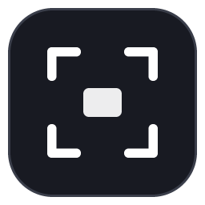

<div align="center">



# Screenshot Enhancer

**The macOS screenshot preview, for Windows.**
Take a screenshot, get a floating thumbnail next to your cursor, and drag it straight into WhatsApp, Slack, Discord, a browser upload field or any folder.
No hunting for files, no opening, no renaming.

[](https://github.com/Primeteumm/Screenshot-Enhancer/releases/latest)
[](https://github.com/Primeteumm/Screenshot-Enhancer/releases)
[](https://github.com/Primeteumm/Screenshot-Enhancer/releases/latest)
[](https://www.electronjs.org/)
[](LICENSE)
[](https://github.com/Primeteumm/Screenshot-Enhancer/stargazers)

[**Download for Windows**](https://github.com/Primeteumm/Screenshot-Enhancer/releases/latest) · [Features](#features) · [Shortcuts](#keyboard-shortcuts) · [How it works](#how-it-works) · [Build from source](#build-from-source)

</div>

<!-- TODO: add a short demo GIF here (take screenshot → thumbnail appears → drag into a chat). It is the single biggest thing for stars.
<p align="center"></p>
-->

---

## Why?

On macOS, every screenshot pops up a little thumbnail you can drag anywhere. On Windows, it lands on the clipboard or in a folder and you have to go find it. Screenshot Enhancer closes that gap: it is a tiny tray app that does what the macOS screenshot preview and [Dropover](https://dropoverapp.com/) do, natively on Windows.

- 🖼️ **Works with the tools you already use.** No new habit needed.
- 🪶 **Stays out of your way.** Never steals focus, click-through everywhere except the thumbnail, fades away on its own.
- 🔒 **Fully offline.** No account, no telemetry, OCR runs on the built-in Windows engine.

## Features

- **Catches every screenshot.** `PrtSc`, `Alt+PrtSc`, `Win+Shift+S`, Snipping Tool, and `Win+PrtSc` (saved to disk) are all detected.
- **Built-in capture.** `Ctrl+Shift+A` for a region, `Ctrl+Shift+F` for the full screen.
- **Drag & drop anywhere.** Grab the thumbnail and drop it. The target app sees a normal file drop. Select several thumbnails and drag them together.
- **Copy text from images (OCR).** Pulls the text in a screenshot to the clipboard using `Windows.Media.Ocr`. Nothing leaves your machine.
- **Quick actions on hover.** Copy, Save as, Open, Show in folder, Pin.
- **Multi-monitor aware.** The thumbnail appears on the screen where the shot was taken, right next to your cursor (or in one of 8 fixed positions).
- **Deeply customizable.** Position, size, stack count, timeout, opacity, theme, animation style and easing, capture sound, shortcuts, file retention.
- **English and Turkish UI.** Follows your Windows language by default.

## Installation

1. Download the installer from the [**latest release**](https://github.com/Primeteumm/Screenshot-Enhancer/releases/latest).
2. Run it. The app lives in your system tray.

> [!NOTE]
> The app is not code-signed yet, so Windows SmartScreen may warn you. Click **More info → Run anyway**.

## Keyboard shortcuts

| Shortcut | Action |
| --- | --- |
| `Ctrl+Shift+A` | Capture a region |
| `Ctrl+Shift+F` | Capture the full screen |
| `Ctrl+Shift+V` | Show the last screenshot again |
| `Ctrl+Shift+P` | Pause / resume screenshot detection |

All shortcuts can be rebound in Settings: click the field and press a new combination. `Backspace` clears it. If another app already owns a shortcut, Settings tells you.

`Esc` cancels region selection. Pausing only stops detection of external screenshots; the capture shortcuts keep working.

## Using the thumbnail

| To | Do this |
| --- | --- |
| Drag the file | Grab the body of the thumbnail and drag |
| Move the thumbnail | Drag the handle at the middle of the top edge |
| Drag several at once | Tick the checkbox at the top left of each, then drag |
| Open the image | Double-click |
| More actions | Hover; buttons appear at the bottom |

The thin line along the bottom edge is the on-screen timer. It pauses while you hover, drag or run an action. Pin a thumbnail to keep it forever.

## Settings

Click the tray icon. Changes apply instantly; there is no Save button.

| Section | Options |
| --- | --- |
| General | Language (system / Türkçe / English), launch at startup, start hidden |
| Capture | Clipboard watching and mode, polling interval, folder watching, extra folders |
| Appearance | Placement (where captured / fixed), 8-way position grid, size, margin, max thumbnails, timeout, opacity, monitor, theme, toolbar |
| Shortcuts | Global shortcuts on/off and all four bindings |
| Sound | Capture sound, volume, preview button |
| Animation | Style (slide / side / scale / fade), easing curve, in/out durations, slide distance |
| Storage | File name prefix, retention period, open / clean folder |

**Test preview** fires a fake capture so you can tune animations without taking screenshots.

## How it works

**Detection** uses two channels. *Clipboard watching* covers anything that copies an image to the clipboard; in the default mode it ignores clipboard contents that also carry text/HTML, so copying an image from a browser does not trigger a thumbnail. *Folder watching* monitors `Pictures\Screenshots`, its localized variants and their OneDrive counterparts, plus any folders you add. `Win+PrtSc` fires both, so duplicates are merged: the temporary copy is dropped and the thumbnail points to the real file on disk.

**Drag & drop** uses Electron's native file drag, so the receiving app sees an ordinary file drop.

**OCR** calls the built-in `Windows.Media.Ocr` engine through PowerShell ([`scripts/ocr.ps1`](scripts/ocr.ps1)). No extra dependencies, no network; languages come from your Windows language settings.

**The capture sound** is synthesized with Web Audio ([`src/renderer/shared/chime.js`](src/renderer/shared/chime.js)), so no audio assets or CSP exceptions are needed.

<details>
<summary><b>Four undocumented Windows / Electron quirks this app works around</b></summary>

<br>

These are hard to find by trial and error, so they are written down here for anyone building a similar overlay.

**1. `setIgnoreMouseEvents(ignore, { forward: true })` does not forward `mousemove` to the renderer.** Two independent measurements got zero events, regardless of `focusable`. Hit testing therefore runs in the main process: the renderer reports card rectangles and the main process polls the cursor every ~24 ms. Toolbar visibility is driven by a `.hot` class from that test instead of CSS `:hover`.

**2. Calling `hide()` on the overlay window and showing it again permanently breaks input.** Even after `setIgnoreMouseEvents(false)`, mouse events never reach the renderer and the buttons stay dead. The window is never hidden; when the last card closes it is just emptied. With no cards it is fully transparent and click-through, and `skipTaskbar` keeps it out of Alt+Tab.

**3. Once the window is fully covered, Chromium considers it hidden forever.** When the `Win+Shift+S` snip overlay, a fullscreen video or a game covers the thumbnail and then goes away, the card stays painted but receives no input. The cause is Chromium's native window occlusion tracking (`CalculateNativeWinOcclusion`), which never recovers for this click-through window. Measured: after a fullscreen window covers it for 1.5 s, the card is no longer clickable; with the feature disabled it works every time. The app disables it at startup.

**4. Making the whole overlay clickable breaks file dragging.** The drag source is the `draggable` card; if an overlay layer swallows `mousedown`, the drag never starts. The layer stays `pointer-events: none` and only the buttons and move handle receive mouse events.

**Bonus, OCR:** recognition depends heavily on glyph height in pixels, and 12–13 px screen text gets garbled. Images are upscaled before OCR. On a 560×200 terminal sample: 94% accuracy raw, 100% at 4× upscale. Scale is capped at 4× and an ~8 MP budget.

Run with `SE_DEBUG=1` to log card rectangles, cursor position and click-through state to the console.

</details>

## Files and privacy

Temporary PNGs are written to `%APPDATA%\screenshot-enhancer\captures` and deleted after the retention period you choose. Cleanup only touches that folder; files in your own Screenshots folder are never deleted. Settings live in `%APPDATA%\screenshot-enhancer\settings.json`.

The app makes no network requests.

## Build from source

Requires [Node.js](https://nodejs.org/) 18+ on Windows.

```bash
git clone https://github.com/Primeteumm/Screenshot-Enhancer.git
```

```bash
cd Screenshot-Enhancer && npm install
```

```bash
npm start
```

Build the installer (output in `dist/`):

```bash
npm run dist
```

Icons are generated in code with no external dependencies:

```bash
npm run icons
```

<details>
<summary><b>Project structure</b></summary>

```
src/main/              main process
  index.js             lifecycle, capture flow, shortcuts, IPC
  i18n.js              resolves the configured language, main-process strings
  config.js            settings (schema-validated merge and migration)
  store.js             capture records and disk cleanup
  clipboardWatcher.js  clipboard polling + cheap fingerprinting
  folderWatcher.js     screenshot folders
  capture.js           screen capture and region selection
  previewManager.js    preview window, geometry, cursor hit testing
  tray.js, settingsWindow.js
src/preload/           contextBridge bridges
src/renderer/
  preview/             the thumbnail
  region/              region selection overlay
  settings/            settings UI
  shared/chime.js      capture sound synthesis
  shared/i18n.js       Turkish / English UI strings (single source)
scripts/               icon generator, OCR script
```

</details>

## Contributing

Bug reports, feature ideas and pull requests are welcome. Open an [issue](https://github.com/Primeteumm/Screenshot-Enhancer/issues) to get started. New UI languages only need entries in [`src/renderer/shared/i18n.js`](src/renderer/shared/i18n.js).

## License

[MIT](LICENSE) © Enes Aydın

---

<div align="center">

If Screenshot Enhancer saves you a few clicks every day, consider giving it a ⭐. It helps other Windows users find it.

</div>
